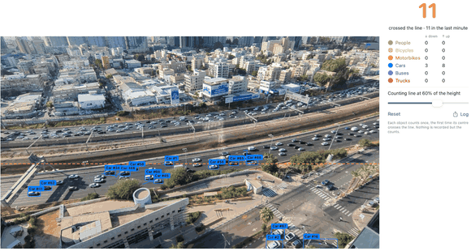

# Hailo-10H on Apple devices: Hailo Studio, Artelico and Artelico Web

Apps for the **ASUS UGen300**, a USB AI accelerator with a **Hailo-10H** chip and 8 GB of its own memory, plus the
same demos without the stick.

*Artelico on a Mac (no stick): the Traffic count demo, YOLOv8s on Core ML, counting cars as they cross the line. Video: Hailo, hailo-apps (MIT).*

Hailo supports the stick on Linux and Windows only. This project drives it from a **Mac, an iPad or an iPhone**:
- the USB protocol is reimplemented in a small C runtime;
- iPadOS reaches the stick through a DriverKit driver.

| Part | What it is | Runs on | Needs the stick? |
|---|---|---|---|
| **Hailo Studio** (`UGenProbe/`) | Hailo's model zoo and the UGen300 demos, running on the stick: photos, live camera and streams, chat, picture questions, speech to text | iPad (DriverKit), Mac (Mac Catalyst) | Yes |
| **Artelico** (`Artelico/`) | The same demos without the stick: the vision models converted to Core ML, plus chat (llama.cpp) and speech (WhisperKit) | iPhone, iPad, Mac | No |
| **Artelico Web** (`web/`) | Artelico in the browser: ONNX Runtime Web (WebGPU or WebAssembly), WebLLM, Transformers.js | Any desktop with Chrome or Edge | No |
| **UGenKit** (`UGenKit/`) | The shared library: the stick's runtime client (C), the model catalogue, decoders, renderers, tracking, the demos' rules, an HTTP server, and the `ugen` command-line tool | Apple platforms | Partly |
| **Notebooks** (`notebooks/`) | Hailo's own Python package (`hailo_platform`) built for macOS, with Jupyter examples | Mac with the stick | Yes |
| **Model tools** (`native/tools/`) | Converting Hailo Model Zoo models to Core ML and ONNX, and checking each one against the stick | Mac (mostly Python) | For checking |

Online, with nothing to install:
- Artelico Web, vision pages: https://huggingface.co/spaces/helmo/artelico
- Artelico Web, everything including the language pages: this repository's GitHub Pages site
  (`https://<owner>.github.io/artelico/`), published by `.github/workflows/pages.yml` on each push to `main`
  that changes `web/`. On a fork, turn it on once: Settings → Pages → Source: GitHub Actions.
- The converted models: https://huggingface.co/helmo/artelico-models
- Each model's licence is listed in that repository's model card. They range from MIT and Apache to GPL/AGPL and a
  few non-commercial ones.

## What the demos do

- **Photos:**
  - detection, pose, instance segmentation, segment everything, classification, depth, semantic segmentation;
  - rotated boxes, super-resolution, text reading (OCR), lanes;
  - faces (detect, landmarks, attributes, recognition), person attributes and re-identification;
  - tagging and finding things from words (CLIP, SigLIP, YOLO-World), stereo depth.
- **Live:** the camera, video files, or RTSP / HTTP / HLS streams; up to 4 at once, with tracking and recording.
  Video files are shown in even steps, and boxes and body points are smoothed, so nothing shakes.
- **The UGen300 demo screens:**
  - Raise hand to flip, Yoga coach, Rep counter, Classroom, Traffic count, Missing check;
  - Privacy camera (blurs faces, plates, text or whole people before anything is shown or recorded);
  - Catch the eggs, Face check-in, Face report;
  - Outfit advisor, Fridge chef, Calories, Edge vs cloud, Photo restore.
- **Language:** chat, questions about a picture, speech to text and, in Artelico, a voice assistant with tools (weather, travel
  times, web search, timers, torch). On the stick: Qwen2.5 / Qwen3 / Llama 3.2, Qwen2-VL and Whisper. In Artelico: llama.cpp and
  WhisperKit. On the web: WebLLM and Transformers.js.
- **A REST API:** other devices on the network can send pictures to the stick through the iPad or Mac.

## Getting started

Everything is built from source. There are no ready-made downloads, because Apple's signing ties each build to the
builder's own developer account.

- **Just try it:** open the Space above, or run the web edition locally:
  `python3 web/serve.py`, then go to http://localhost:8000.
- **Mac, iPad, iPhone:** [docs/building-apple.md](docs/building-apple.md). In short:
  1. Install Xcode and XcodeGen.
  2. Run `tools/fetch_runtime_image.sh`, which gets the stick's runtime from ASUS.
  3. Build llama.cpp for Artelico.
  4. Run `tools/generate_projects.sh` with your team ID, then build.
- **Python and Jupyter with the stick on a Mac:** [notebooks/README.md](notebooks/README.md).
- **Linux or Windows:** [docs/porting.md](docs/porting.md). It covers what works there today (the web edition, and
  Hailo's own runtime and Python package) and how the stick runtime and the apps could be ported.

Using a coding assistant (Claude Code or similar)? Point it at this folder. [CLAUDE.md](CLAUDE.md) and the
`CLAUDE.md` in each part tell it how the project fits together, how to build and test it, and what to watch out for.

## Documentation

| File | About |
|---|---|
| [CLAUDE.md](CLAUDE.md) | The map: folders, build and test commands, conventions, pitfalls |
| [docs/building-apple.md](docs/building-apple.md) | Building and installing the apps, signing, the iPad driver |
| [docs/the-stick.md](docs/the-stick.md) | How the UGen300 works: loader mode, the runtime image, the HailoRT RPC protocol, GenAI |
| [docs/models.md](docs/models.md) | Where models come from: Hailo's HEF files, the Core ML / ONNX conversions, `.native.json` maps |
| [docs/porting.md](docs/porting.md) | Linux (e.g. Ubuntu) and Windows |
| [docs/road-cameras.md](docs/road-cameras.md) | Using public traffic cameras as live sources (no addresses are included) |
| [docs/FOLLOWUPS.md](docs/FOLLOWUPS.md) | Open questions and known gaps |
| [docs/history/LOG.md](docs/history/LOG.md) | The full development log: every step, measurement and decision, in order |
| Each folder's `CLAUDE.md` | That part in detail |

## What is not in this repository, and how to get it

| Missing | Why | How to get it |
|---|---|---|
| `images/core-image-hailo-hailo10-usb-dongle.ext4` (the stick's runtime, 103 MB) | Hailo's / ASUS's file | `tools/fetch_runtime_image.sh` downloads ASUS's official package and extracts it, with a checksum check |
| Model files (`.hef`, Core ML, ONNX) | Large; each has its own licence | The apps download them when first used: HEFs from Hailo's servers, conversions from Hugging Face |
| `vendor/llama-b12138-artelico/llama.xcframework` | Built from llama.cpp's source | [docs/building-apple.md](docs/building-apple.md#3-llamacpp-for-artelico) |
| `tddfa_bfm68.bin` (3D face landmarks) | Basel Face Model licence | Accept the licence, then run `native/tools/make_tddfa_bfm68.py`. Without the file, that one model is just not offered |
| Hailo's demo videos | Large | Downloaded from the model repository on Hugging Face the first time one is chosen |
| A list of road cameras | Left out on purpose | [docs/road-cameras.md](docs/road-cameras.md) says where to find public ones |

## Hardware

- **ASUS UGen300 USB AI accelerator:** Hailo-10H, 8 GB LPDDR4, USB-C.
  - It runs on HailoRT 5.3.0 firmware. A new stick may need ASUS's one-time firmware update, done from a Linux PC
    (see [docs/the-stick.md](docs/the-stick.md#firmware)).
- **iPad:** M1 or later with USB-C. Tested on an iPad Pro 12.9" (M1). The single port is taken by the stick, so
  installing and testing happen over Wi-Fi.
- **Mac:** Apple Silicon, macOS 14 or later. The Python package is built on your Mac and targets that macOS version.
- **iPhone:** Artelico runs on the iPhone. Hailo Studio's driver is untested there.

## Credits and licences

- This repository's code is under the **GNU AGPL-3.0** ([LICENSE](LICENSE)).
- Third-party parts keep their own licences:
  - in `web/vendor/`: ONNX Runtime Web (MIT), Transformers.js (Apache-2.0), WebLLM (Apache-2.0);
  - the tokenizer files in `UGenKit/Sources/StudioCore/Resources` and `web/data` (each names its source and
    licence).
- **Sample pictures:** Hailo's hailo-apps (MIT) and the UGen300 demos (MIT), plus Google MediaPipe (Apache-2.0)
  for `thumbs_up.jpg`. Each app shows the credit next to the sample.
- **Sample videos:** Hailo (MIT).
- **Thanks to:**
  - the third-party loader protocol notes and the macOS HailoRT port that showed the way (see
    [docs/the-stick.md](docs/the-stick.md));
  - Hailo's open-source HailoRT and Model Zoo;
  - ASUS's UGen300 firmware package and demos.
- Hailo, ASUS and UGen300 are trademarks of their owners. This is an independent project, not made or endorsed by
  them.
